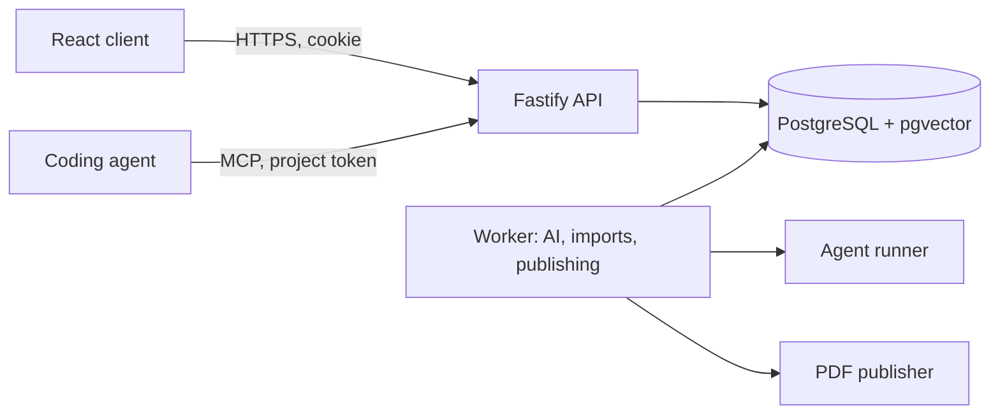

# SDD Studio — Design

> How SDD Studio is built, in the Google design-document format: context and scope, goals and non-goals, design, alternatives considered, cross-cutting concerns. The last section is the visual design system for agents that generate UI. Deeper detail: [docs/design.md](docs/design.md) (architecture, data, flows) and [docs/architecture/components.puml](docs/architecture/components.puml) (enforced dependencies).

## Context and scope

SDD Studio is a self-hosted web application for writing, reviewing and handing off software design documents. It stores one specification per project, runs AI work in a durable worker, and exchanges content with Git, trackers, coding agents (MCP) and people (exports). See [PRODUCT.md](PRODUCT.md) for the problem and users.

## Goals and non-goals

**Goals:** no silent overwrite; AI only proposes; the same domain rules in browser and server; one database; every route documented and protected; WCAG 2.2 AA.

**Non-goals:** multi-region replication; real-time co-editing (revisions and merges instead); running untrusted code (agents run in an isolated runner with read-only tools).

## Design

| Decision | Choice | Why |
| --- | --- | --- |
| Domain logic | `packages/shared` with no I/O | The browser and the server apply the same patches, readiness and parsing |
| Persistence | PostgreSQL JSONB behind a document-collection adapter | One database for documents, blobs and vector search; the API code stayed unchanged when moving from MongoDB |
| Writes | Partial patches with an expected revision | Autosave without locks; conflicts are explicit (409) |
| AI and imports | Proposals with three-way merge | People keep authority; old proposals never undo newer work |
| Jobs | Collection-backed queue with leases and heartbeats | Survives restarts without a separate broker |
| Agents | Stateless MCP over HTTP, per-project tokens | Works with any MCP client; tokens stored as digests |
| Optional features | Feature flags checked by a global route guard and in the UI | Admins switch capabilities off without a deploy |

## Alternatives considered

| Alternative | Rejected because |
| --- | --- |
| Keep MongoDB | Two databases (documents plus vectors) to run; teams already operate PostgreSQL |
| CRDT real-time editing | High complexity; answers are small fields that merge well by revision |
| Let AI write directly | Violates reviewability; hallucinated answers would reach baselines |
| Server-rendered pages | The workspace is highly interactive; the public page gets JSON-LD and a no-JavaScript summary instead |
| An external rules library for architecture tests | A small in-repository engine (`tests/arch/rules.ts`) plus ArchUnitTS cover what is needed |

## Cross-cutting concerns

| Concern | How |
| --- | --- |
| Security | Roles checked by `projectFor` on every route (a test sweeps them all); strict CSP; origin check; encrypted secrets; audit; fixed outbound hosts |
| Privacy | Local-only projects stay local; public files contain no project data (tested) |
| Observability | Prometheus metrics, Grafana dashboard, Netdata, OpenTelemetry, admin panel |
| Performance | Bundle budgets, Lighthouse budgets, backend load budgets (`pnpm perf`) |
| Accessibility | axe on every story and every view, target-size and layout checks at three widths |
| Quality | 15 test types (see [docs/testing.md](docs/testing.md)) with coverage floors |

## Visual design system (for UI agents)

Use these rules when generating or changing UI. Tokens live in `apps/web/src/style.css` and components in `apps/web/src/components/ui.tsx`.

- **Tone:** calm, minimal, document-first. Neutral surfaces and one accent colour. Colour carries status, never decoration.
- **Tokens:** `--bg`, `--surface`, `--subtle`, `--line`, `--text`, `--muted`, `--accent` (light `#2f5bd3`, dark `#86a8ff`), and the status pairs `--green`, `--amber`, `--red`, `--violet` with their `-soft` variants. Radius `--radius` is 10px. Never hard-code colours. The edge of a control (text field, select, switch) uses `--control-line` (at least 3:1 on every surface); `--line` and `--line-strong` are for dividers only. Every text pair is at least 4.5:1 in light and dark, and `prefers-contrast: more` strengthens secondary text, dividers and control edges.
- **Type:** system sans-serif by default. Users may switch to high legibility, humanist, serif or mono, and change the size. Code uses `--mono`.
- **Components:** Button (primary, secondary, ghost, danger; md, sm, icon), Badge, Tabs, Segmented, Switch, Modal, EmptyState, ProgressRing and ProgressBar. Icons come from Lucide.
- **Layout:**
  - Desktop: a sidebar of views that folds into a 64 px icon rail on its own between 761 and 1100 px.
  - Phone: a "Views" menu that also holds Dashboard, Settings and the account, so content starts on the first screen; no breadcrumb row.
  - Cards in grids that collapse to one column below 760 px.
- **Interaction:**
  - Autosave with a visible status.
  - Every drag and drop has a menu alternative.
  - Destructive or external actions name their consequence.
  - Empty states offer the next step.
- **Motion:**
  - Use the springs in `apps/web/src/motion.ts`, never ad-hoc durations. `spring.ui` (no overshoot) is the default; `spring.snappy` for small controls; `spring.momentum` (a little bounce) only after a gesture that carried velocity.
  - Things leave the way they came: dialogs scale and fade in and out on the same path, and a walkthrough step enters from the side it is travelling towards.
  - Pressable controls scale to 0.97 on pointer-down (transform only, so layout and contrast never change).
  - Boundaries give instead of stopping dead: dragging past a limit uses `rubberband()` and springs back on release.
  - Materials: the top bar is translucent with a blur; it turns solid under `prefers-reduced-transparency` and `prefers-contrast: more`.
  - Reduced motion makes every change instant; entrances use `enterFrom(reduce, …)` so nothing moves.
- **Accessibility:** 24 × 24 px minimum targets, visible focus, labels on every control, bilingual text (English and French), no information by colour alone, no text below 0.75rem. Light and dark follow the system unless the person picks one, and reduced motion turns off animation.
- **Review:** UI changes are checked against Apple's Human Interface Guidelines as translated in [docs/ux-review.md](docs/ux-review.md) (accessibility, then conventions, then craft); deliberate deviations are listed there.
