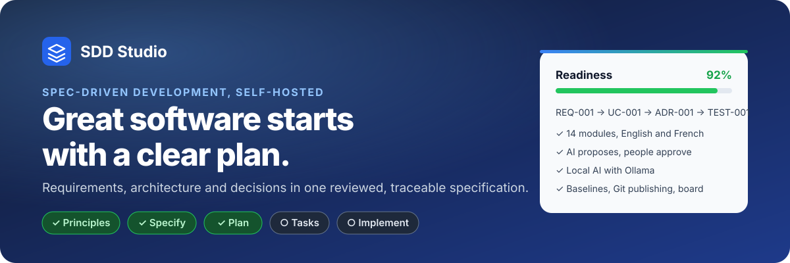
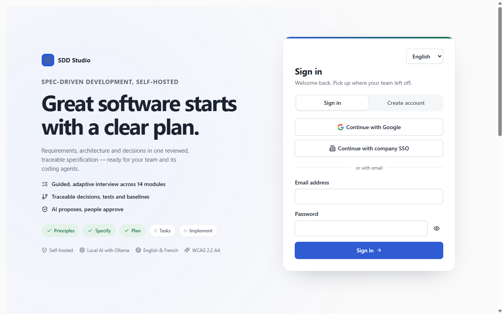

<p align="center">
  
</p>

<p align="center">
  <a href=".github/workflows/ci.yml"></a>
  
  
  
  
  
  <br>
  
  
  
  
  
  
</p>

**SDD Studio** is a self-hosted workspace for writing software design documents. A guided interview across 14 specification modules turns an idea into a reviewed, traceable specification that your team and its coding agents can build from. AI helps by proposing changes. People review and accept them.

<p align="center">
  
</p>

## Why SDD Studio

|                                          |                                                                                                                                                                                       |
| ---------------------------------------- | ------------------------------------------------------------------------------------------------------------------------------------------------------------------------------------- |
| **Guided specification**                 | 14 modules, from business discovery to governance and handoff, in English and French. Questions adapt to the project type and to the technology stack you pick.                       |
| **Traceability**                         | Requirements, use cases, architecture decisions and tests link to each other (`REQ-001 → UC-001 → ADR-001 → TEST-001`). Readiness and completeness scores show what is still missing. |
| **AI that proposes, people who approve** | OpenAI, Anthropic, NVIDIA NIM (including its free hosted endpoint), Claude Agent or local Ollama models suggest changes as proposals. Nothing is written until a reviewer accepts it, and conflicting edits get a three-way merge.     |
| **Local and private**                    | Local-only projects use Ollama and never fall back to the cloud. Small models get a compact context focused on the sections you ask about.                                            |
| **Technology catalog and stack**         | A multi-version catalog (cloud, data, search, infrastructure as code…) with license rules and stack rules that pre-fill answers.                   |
| **From plan to delivery**                | Baselines, Markdown/PDF/LaTeX/image exports, Spec Kit files, an implementation board synced with `.plan/tasks.md`, and Git publishing through pull requests.                          |
| **Enterprise-ready**                     | Roles (Owner, Admin, Editor, Reviewer, Viewer), company SSO and Google, encrypted credentials, audit log, feature flags, and OpenAPI docs at `/api/docs`.                             |

## Quick start

Clone the repository before running the commands below:

```bash
git clone https://github.com/antoinebou12/Spec-Driven-Helper.git
cd Spec-Driven-Helper
```

The website includes a specification visualizer under Overview. Connect an MCP Apps assistant to `/api/v1/mcp` with a project token to open the same view with `show_specification` and request improvements through reviewed proposals. See [MCP connection and visualizer](docs/ai-readiness.md#visualize-and-improve-a-specification-in-your-assistant).

With Docker:

```bash
cp .env.example .env          # set ENCRYPTION_KEY, BOOTSTRAP_EMAIL, BOOTSTRAP_PASSWORD
docker compose up -d --build  # PostgreSQL, app and worker on http://localhost:3001
```

Add local AI with `docker compose --profile ollama up -d` (models run in a container), or keep using an Ollama already running on your machine. Then check it:

```bash
pnpm ollama:check
```

For development:

```bash
corepack enable && pnpm install
pnpm exec tsx scripts/setup-local.ts   # creates .env and a local Owner account
docker compose up -d postgres
pnpm dev                               # http://localhost:5173, API on 3001
```

## Documentation

| Guide                                             | What it covers                                                                              |
| ------------------------------------------------- | ------------------------------------------------------------------------------------------- |
| [AI readiness](docs/ai-readiness.md)              | llms.txt, JSON-LD and crawler rules (AIO); the MCP server for coding agents and its quality gate |
| [Testing](docs/testing.md)                        | Every test layer, its command, coverage floors, accessibility, Lighthouse and fixtures |
| [Installation](docs/installation.md)              | Docker Compose profiles, manual install on Windows, macOS and Linux, Ollama, single sign-on |
| [Operations](docs/operations.md)                  | Health checks, upgrades, backup and restore, security operations, troubleshooting           |
| [Software design](docs/design.md)                 | Context, containers, data, main flows, patterns, UX design system and verification strategy |
| [Running the CI locally](docs/ci-local.md)        | The GitHub Actions jobs in Docker with `act`                                                |
| [Architecture](docs/architecture/dependencies.md) | Component diagram and dependency rules                                                      |
| [All documentation](docs/README.md)               | Index of every guide                                                                        |
| [Agent instructions](AGENTS.md)                   | Feature map, invariants and commands for coding agents                                      |

## Quality checks

| Check                                           | Command                                              |
| ----------------------------------------------- | ---------------------------------------------------- |
| Types, lint, formatting                         | `pnpm typecheck` · `pnpm lint` · `pnpm format:check` |
| Backend and domain tests (needs `DATABASE_URL`) | `pnpm test`                                          |
| Component tests                                 | `pnpm exec vitest run --config vitest.web.config.ts` |
| Browser journeys with axe                       | `pnpm test:e2e`                                      |
| Storybook accessibility sweep                   | `pnpm exec storybook build && pnpm test:stories`     |
| Whole CI pipeline locally                       | `pnpm ci:local`                                      |

## Project layout

```
apps/api        Fastify API and durable job worker
apps/web        React and Vite client, Storybook stories
apps/publisher  Isolated PDF renderer
apps/agent-runner  Isolated Claude Agent workspace
packages/shared Domain logic shared by the API and the client
tests/          Vitest suites and Playwright journeys
.plan/          Implementation record: tasks, changes, backlog
```
