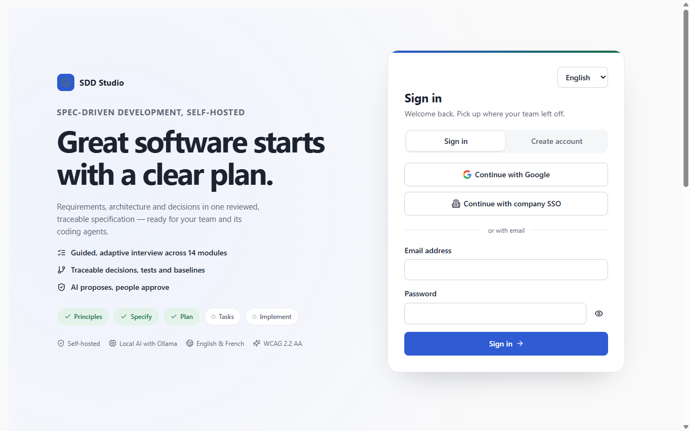
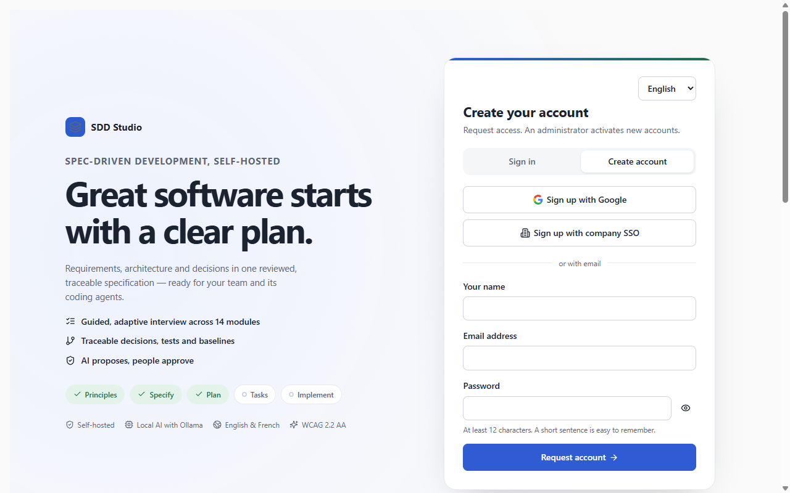
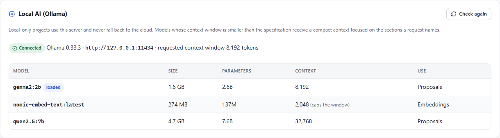

# SDD Studio documentation

Start with [Installation](installation.md), then keep [Operations](operations.md) at hand once the workspace runs. The [User guide](user-guide.md) walks through every page, from an empty project to a published baseline.

## Run it

- [Installation](installation.md): Docker Compose and its profiles (`ollama`, `pdf`, split images, GPU), manual installation on Windows, macOS and Linux, the environment variables, local AI with Ollama, and single sign-on with company SSO or Google.
- [Operations](operations.md): health checks and monitoring, upgrades, backup and restore, security operations and troubleshooting.
- [Administration and access](administration.md): role matrix, bootstrap accounts, local-origin errors, feature switches, integrations, Ollama/search and observability boundaries.

## Understand it

Repository and document imports start from **Overview > Import existing work**. Review the findings in the dialog, then accept the resulting proposal in Proposals. Existing import bookmarks open the same dialog. Configure coding-agent MCP tokens and external connectors in **Settings > Integrations**; workspace feature switches are in **Settings > Administration**. Overview's score explanation, workflow and revision history expand on demand.

- [Glossary](glossary.md): the words SDD Studio uses, from answer block to use case.
- [AI readiness](ai-readiness.md): llms.txt and structured data for assistants; the MCP server for coding agents and its quality gate.
- [Testing](testing.md): the 15 test types, their commands, coverage floors, accessibility and performance budgets.

- [Software design](design.md): quality goals, system context, containers, data design, main flows, cross-cutting concerns, design patterns, the UX design system, deployment, verification strategy and open risks.
- [Architecture dependencies](architecture/dependencies.md): the component diagram ([PlantUML source](architecture/components.puml)) and the dependency rules enforced by the architecture tests.
- API reference: every route is documented in OpenAPI 3.1. A running server shows it at `/api/docs` (Swagger UI).

## Change it

- [Agent and contributor instructions](../AGENTS.md): layout, invariants, feature map and the checklist for adding questions, routes, flags and components.
- [Running the CI locally](ci-local.md): the GitHub Actions jobs in Docker with `act`, and the known differences from GitHub.
- [Implementation record](../.plan/README.md): tasks, change log, backlog and expanded scope.

## Screenshots

| Sign in                                                                                      | Create an account                                                                                                      |
| -------------------------------------------------------------------------------------------- | ---------------------------------------------------------------------------------------------------------------------- |
|  |  |

