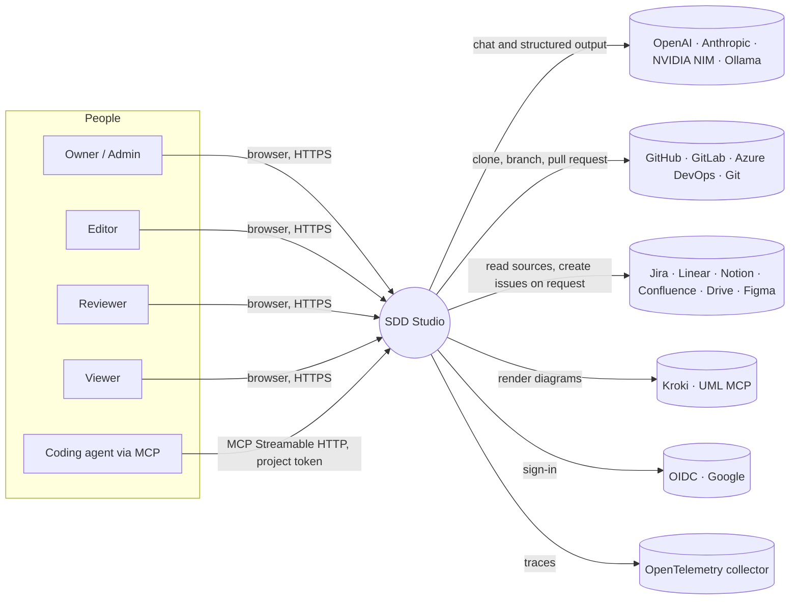
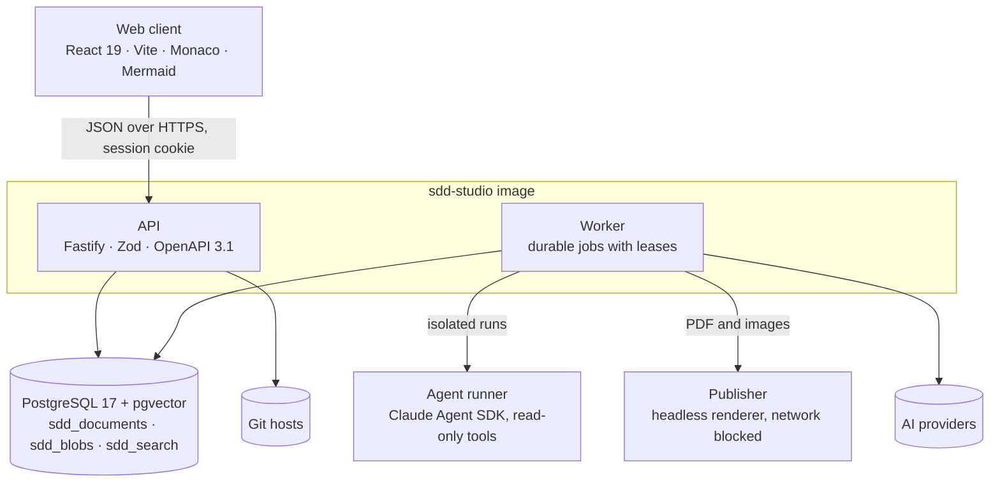
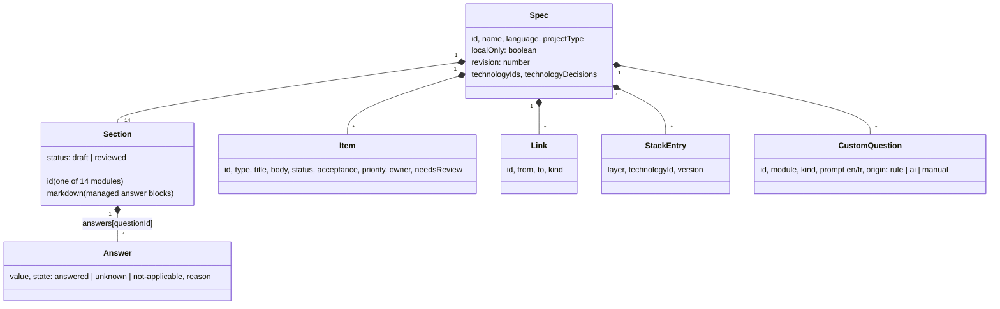
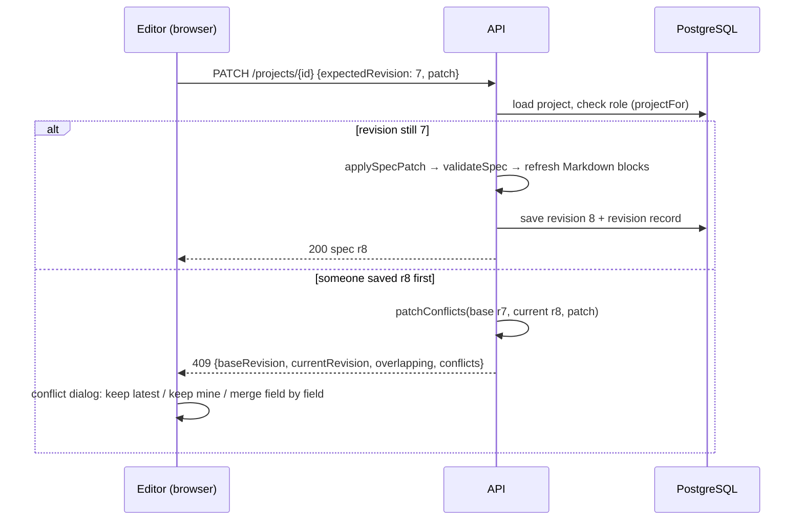
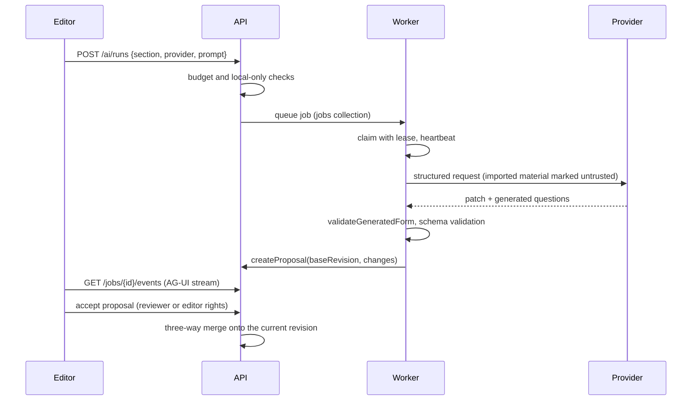
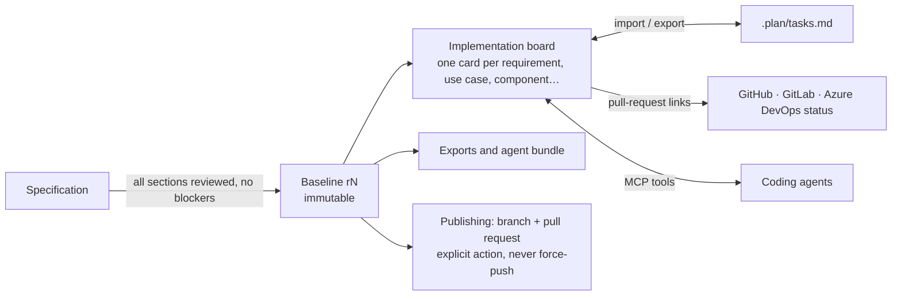

# SDD Studio — software design

This document describes how SDD Studio is built: its context, containers, data, main flows, security, the design patterns it relies on, and its user-experience design system. Individual decisions are recorded as ADRs in [`.plan/designs.md`](../.plan/designs.md); the file and test map for each feature is in [`AGENTS.md`](../AGENTS.md).

## 1. Purpose and quality goals

SDD Studio helps a team write a complete, reviewable software design document (SDD). The document has 14 bilingual modules (English and French) and covers technology choices, traceability, readiness checks and immutable baselines. The team then hands the result to people and coding agents through exports, Git and an implementation board.

| Priority | Quality goal         | What it means here                                                                                              |
| -------- | -------------------- | --------------------------------------------------------------------------------------------------------------- |
| 1        | Integrity            | No silent overwrite: every write carries a base revision; AI, imports and workers only propose; baselines never change. |
| 2        | Security and privacy | Self-hosted, least privilege, encrypted credentials, untrusted input treated as data, local-only projects stay local.   |
| 3        | Clarity              | A beginner can answer the interview; an expert can edit Markdown directly; both see the same document.                 |
| 4        | Accessibility        | WCAG 2.2 AA, keyboard alternatives for every drag and drop, light and dark themes, adjustable font and size.           |
| 5        | Operability          | One container image, PostgreSQL only, health checks, metrics, audit, documented backup and restore.                      |

## 2. System context

Every outbound integration is optional and configured by an Owner or Admin. Local-only projects never reach cloud AI providers or external renderers.

## 3. Containers

| Container    | Responsibility                                                                        | Trust and limits                                                                 |
| ------------ | ------------------------------------------------------------------------------------- | -------------------------------------------------------------------------------- |
| Web client   | Interview, Markdown editor, board, catalog, review and settings screens.                | Has no secrets. Hiding a control is never access control; the API decides.      |
| API          | Authentication, RBAC, validation, revision-guarded writes, proposals, exports, MCP.      | The only component that changes specifications. Security headers, strict origin check. |
| Worker       | AI runs, repository inspection, imports, publishing jobs. Emits AG-UI events.          | Produces proposals only; it cannot publish or approve.                           |
| Agent runner | Claude Agent sessions in a throw-away workspace.                                       | Read-only tools, PreToolUse path policy, minimal environment, audited tool log.   |
| Publisher    | PDF reports and images from approved content.                                          | Network access blocked during rendering.                                         |
| PostgreSQL   | All state: JSONB documents, binary assets, full-text and vector search.                | The only stateful service to back up (with `ENCRYPTION_KEY`).                    |

### API modules

| Module                            | Role                                                                                     |
| --------------------------------- | ---------------------------------------------------------------------------------------- |
| `app.ts`                          | Server assembly: headers and CSP, origin check, sessions, rate limits, error model, route registration. |
| `projects.ts`                     | `projectFor` (membership and role check, normalisation), `saveSpec`, stale-write conflicts, `createProposal`. |
| `specs.ts`, `review.ts`           | Specification editing, section review, proposals, baselines.                             |
| `ai.ts`, `providers.ts`, `jobs.ts` | Provider adapters (a strategy per provider), job queue, AG-UI event stream.            |
| `importer.ts`, `git.ts`           | Repository and document import, safe archive extraction, Git transport.                  |
| `publishing.ts`, `exports.ts`     | Explicit publishing, pull requests, exports (JSON, Markdown, XML, TOON, LaTeX, bundle).  |
| `board.ts`                        | Implementation board, `.plan/tasks.md` import and export, pull-request status.          |
| `mcp.ts`                          | MCP server for agents: board and specification tools; changes become proposals.         |
| `catalog.ts`, `catalog-seed.ts`   | Versioned technology catalog for stack selection; no radar view.                          |
| `admin.ts`, `search.ts`, `google-auth.ts`, `diagrams.ts` | Administration and statistics, section search, Google sign-in, Kroki and UML MCP. |
| `openapi.ts`                      | Route documentation table, Swagger UI at `/api/docs`; a test fails when a route is undocumented. |
| `postgres.ts`, `db.ts`, `migrations.ts` | Storage adapter, connection, numbered run-once migrations under an advisory lock. |

The domain logic lives in `packages/shared` and does no I/O, so the browser and the server run the same rules (patch application, readiness, completeness, Markdown blocks, board parsing).

## 4. Data design

### Storage

PostgreSQL holds three tables:

- `sdd_documents(namespace, collection, key, data jsonb)` — one row per document, with a GIN index on `data`. `PostgresStore` exposes the small document-collection interface the API was written against (`findOne`, `updateOne`, `$set`, `$inc`, `$push`, …). Each mutation runs in a transaction with a per-collection advisory lock.
- `sdd_blobs(namespace, id, bytes)` — uploaded and generated assets.
- `sdd_search(namespace, project_id, section_id, revision, title, body, embedding vector, document tsvector)` — section search, full-text and semantic.

`namespace` isolates databases (tests use `sdd_test_*`, which is the only namespace the store will drop).

| Collection          | Content                                                                                        |
| ------------------- | ---------------------------------------------------------------------------------------------- |
| `users`, `sessions`, `invites` | Accounts (hashed passwords), session digests with expiry, invitations.              |
| `projects`          | `{id, spec, members: {userId: role}, aiRunLimit, aiTokenBudget}`.                              |
| `revisions`         | Every accepted specification revision, with author and provenance (unique per project and revision). |
| `proposals`         | Pending, accepted or rejected changes with `baseRevision`, computed `changes` and field conflicts. |
| `baselines`         | Insert-only snapshots of an approved revision.                                                  |
| `boards`            | One implementation board per project, with its own revision.                                    |
| `jobs`              | Durable jobs: status, lease, attempts, AG-UI events.                                             |
| `catalog`           | Technologies with versions; legacy ring/movement metadata retained for compatibility, not shown as a radar. |
| `git`, `connectors` | Integration settings; secrets encrypted with AES-256-GCM using `ENCRYPTION_KEY`.                 |
| `mcpTokens`         | Digests of project-scoped MCP tokens (the token itself is shown once).                           |
| `audit`, `migrations`, `settings` | Privileged-operation log, applied migrations, runtime configuration.               |

### Specification model

Section Markdown contains managed blocks, `<!-- sdd:answer id -->…<!-- sdd:end -->`, which are regenerated from answers. Free text outside the blocks is kept exactly as written. An edit inside a block becomes an *implied answer* proposal rather than silently changing the structured answer.

## 5. Main flows

### 5.1 Editing with optimistic concurrency

A patch is partial: answers merge per question; items, links and custom questions are upserted and removed only by explicit `remove*` lists.

### 5.2 AI proposal

Model output is never executed. Generated forms are limited to known field kinds and validated on the server.

### 5.3 Import of existing work

A repository (zip upload, Git URL or configured remote) or a document (Markdown, text or HTML) is read with size and path checks. Files that look like secrets (`.env`, keys, certificates) are skipped. Visible rules (`import-rules.ts`) detect the stack, CI/CD, contracts, tests and containers. Document headings are mapped to questions, and unmatched text is kept as notes. Optionally, an AI run reads the same material as untrusted input. Every path ends as a proposal.

### 5.4 From baseline to delivery

Regenerating the board from a newer baseline keeps each card's column, assignee and pull requests. Cards whose items disappeared are marked obsolete, never deleted. Pull-request status is fetched only on request and only from the three fixed hosts. It can suggest a column but never moves a card.

## 6. Cross-cutting design

### Roles

| Action                                         | Owner | Admin | Editor | Reviewer | Viewer |
| ---------------------------------------------- | :---: | :---: | :----: | :------: | :----: |
| Read specification, board, exports              | ✓     | ✓     | ✓      | ✓        | ✓      |
| Edit answers, items, board; run AI; import      | ✓     | ✓     | ✓      |          |        |
| Review sections, accept proposals, approve baselines | ✓ | ✓  |        | ✓        |        |
| Members, integrations, budgets, MCP tokens      | ✓     | ✓     |        |          |        |

Editing and reviewing are deliberately separate (maker–checker). Roles are enforced by `projectFor(user, id, action)` on every route. Users who are not members get 403 and do not see the project in lists.

### Security controls

- **Browser:**
  - Strict CSP and `Referrer-Policy: same-origin`.
  - Every state-changing request must come from `APP_ORIGIN`.
  - `HttpOnly`, `SameSite` session cookies, `Secure` over HTTPS.
  - Rate limits on authentication and outbound calls.
- **Secrets:**
  - AES-256-GCM encryption with `ENCRYPTION_KEY`.
  - Never returned to the browser after they are saved.
  - Redacted from logs.
- **Outbound requests:**
  - Fixed hosts or operator allow-lists.
  - `redirect: 'error'`, timeouts and response size limits.
  - Credentials sent only to their own host and repository.
- **Untrusted content:**
  - Archives are checked for traversal and symlinks, with file-count and byte limits.
  - Imported text is marked as untrusted in AI prompts.
  - Diagram sources may not contain includes or external URLs.
- **Agents:**
  - The agent runner allows only read-only tools, and its PreToolUse hook denies paths outside the workspace.
  - MCP tokens are per project, stored as digests, and can only create proposals and move board cards.
- **Audit:** role changes, credentials, imports, board generation and imports, baselines, publishing, MCP token use and administration settings.

### Concurrency and durability

- Specifications and boards use optimistic revisions. Proposals keep their base revision and are merged field by field.
- Jobs are claimed with a lease and renewed by a heartbeat. A crashed worker's job becomes claimable again after the lease expires, up to three attempts.
- Migrations run once each, under a PostgreSQL advisory lock, because the API and the worker start at the same time.

### Internationalisation

Every question, label and message has `en` and `fr`. The document language and the interface language are chosen independently.

### Observability

- JSON logs (pino) with redaction.
- Prometheus metrics at `/api/metrics`, protected by a token or restricted to local requests.
- OpenTelemetry traces.
- Liveness and database health endpoints.

## 7. Design patterns in use

| Pattern                              | Where                                                                  | Why                                                                  |
| ------------------------------------ | ---------------------------------------------------------------------- | -------------------------------------------------------------------- |
| Adapter                              | `PostgresStore` implements a document-collection interface over JSONB   | Kept the API unchanged while moving from MongoDB to PostgreSQL.         |
| Strategy                             | `providers.ts` (OpenAI, Anthropic, NVIDIA NIM, Ollama, Claude Agent)     | One run pipeline, many models; local-only chooses the Ollama strategy.  |
| Command (partial patch)              | `SpecPatch` + `applySpecPatch`                                          | Small, mergeable, auditable changes.                                    |
| Maker–checker                        | Proposals and section review                                            | AI, imports and agents cannot approve their own changes.                |
| Optimistic concurrency               | `expectedRevision` on specifications and boards                         | No locks held while people think; conflicts are explicit.              |
| Three-way merge                      | `threeWayMerge`, `patchConflicts`                                       | Accepting an old proposal does not undo newer work.                     |
| Competing consumers with leases      | `jobs.ts`                                                               | Safe horizontal workers and crash recovery.                             |
| Rule engine / pipeline               | `import-rules.ts`, `stackRules`                                         | Explainable, testable detection instead of opaque heuristics.          |
| Anti-corruption layer                | `import-mapping.ts`, `.plan` parser                                     | External formats are translated into the domain model at the boundary. |
| Immutable snapshot                   | Baselines                                                               | A stable reference for handoff, board generation and publishing.       |
| Policy enforcement point             | Agent-runner PreToolUse hook, `projectFor`                              | Authorisation decided in one place per boundary.                       |
| Specification-by-schema              | Zod schemas → JSON Schema → OpenAPI                                     | One source of truth for validation and documentation.                  |

## 8. User-experience design system

### Principles

1. **Document first.** The interview and the document sit side by side, and every answer is visible in the Markdown it produces.
2. **Minimal and calm.** Neutral surfaces with a single accent colour. Colour shows status, not decoration. There are no marketing screens inside the workspace.
3. **Progressive disclosure.** Beginner explanations, expert hints, examples and references are one click away, not always on screen.
4. **Nothing surprising.** Autosave is always visible, conflicts open a dialog, and AI changes wait in Proposals.
5. **Keyboard complete.** Every drag and drop has a menu or button alternative. Alt+1…9 and Alt+0 open views, and `?` lists all shortcuts.

### Layout

- **Sidebar:** Build with AI, Overview, Stack, Specification, Requirements and decisions, Proposals, Readiness, Board and Publishing. Dashboard and Settings sit at the bottom. Import opens over Overview; search opens from the top bar. Legacy Open Questions and Radar bookmarks redirect to Specification and Stack.
- **Top bar:** project switcher, save status, language, theme, display settings, Ask AI and help.
- **Specification workspace:** interview on the left and document on the right, with a keyboard-resizable divider. On narrow screens it becomes two tabs.
- **Boards:** the stack step and implementation board use column layouts that collapse to one column below 760 px.

### Tokens

Colours are CSS custom properties with light and dark values (`[data-theme='dark']`). Components use tokens only.

| Token                              | Light     | Dark      | Use                                     |
| ---------------------------------- | --------- | --------- | --------------------------------------- |
| `--bg` / `--surface` / `--subtle`  | #fafafa / #ffffff / #f5f6f8 | #0d1117 / #121821 / #171f2b | Page, cards, columns                    |
| `--line` / `--line-strong`         | #e7e9ee / #cfd4dc | #242d3b / #344052 | Borders and dividers              |
| `--text` / `--muted`               | #1b2230 / #5d6675 | #e6ebf4 / #a0acc2 | Body text, secondary text        |
| `--accent` / `--accent-soft`       | #2f5bd3 / #eef2fd | #86a8ff / #1d2b4e | Primary actions, selection, drop targets |
| `--green`, `--amber`, `--red`, `--violet` (+ `-soft`) | status | status | Ready, warning, blocker, AI/merged |
| `--radius`                         | 10px      | 10px      | Cards and inputs                         |

- **Type:** the default is the system sans-serif (Inter or Segoe UI). Users can choose high legibility (Atkinson Hyperlegible), humanist, serif or monospace, and a text size.
- **Code:** code and identifiers use `--mono`.
- **Icons:** icons come from Lucide. Technology logos come from Simple Icons, with a category icon when no logo exists.

### Components

- **Primitives** (`components/ui.tsx`): Button (primary, secondary, ghost, danger; md, sm, icon), Badge (tones), Tabs, Segmented, Switch, Modal (Radix Dialog), EmptyState.
- **Domain components:**
  - `AnswerControl`, which picks the input for each question kind: text, choice, multi, switch, slider, checklist, table, RACI, requirements, comparison.
  - ProgressRing and ProgressBar, Tour, ConflictDialog, GeneratedUI, RunActivity, Markdown and Diagram, Splitter, TechIcon.
- **Documentation:** every primitive has a Storybook story with light, dark, English and French toolbars, and the a11y addon runs in error mode.

### Interaction patterns

| Situation              | Pattern                                                                                      |
| ---------------------- | -------------------------------------------------------------------------------------------- |
| Typing an answer       | Debounced autosave; status "Saving… / All changes saved" in the top bar; Ctrl+S saves now.     |
| Someone saved first    | Conflict dialog showing both values; choose per field. Nothing is lost silently.              |
| AI help                | Ask AI → provider picker → live activity → proposal card with a diff → accept or reject.       |
| Drag and drop          | Drop target highlight; every card also has a "Move…" select; screen readers get labels.        |
| First visit            | Guided tour that spotlights each area; restart from Help.                                    |
| Progress               | Completeness ring (weighted) on Overview, separate from readiness blockers.                  |
| Destructive or external actions | Explicit button with the consequence in its label (for example "Approve revision 12 as baseline"). |

### Accessibility

- Aims to meet WCAG 2.2 AA; Storybook's a11y addon and axe checks in the browser tests catch regressions.
- 24 × 24 px minimum targets and visible focus rings.
- `prefers-reduced-motion` is respected.
- Landmarks and a skip link. Live regions announce save status and notices.

## 9. Deployment

| Option              | Shape                                                                                                     |
| ------------------- | --------------------------------------------------------------------------------------------------------- |
| Docker Compose      | `app`, `worker` (same image), `postgres` (pgvector). Ports bound to 127.0.0.1 behind a TLS proxy.          |
| Kubernetes (Helm)   | `deploy/helm/sdd-studio`: API and worker Deployments, Service, optional Ingress, Secret, non-root security context, probes. PostgreSQL is external. |
| Manual              | Node.js 24, PostgreSQL 17 with pgvector, two services (`pnpm start`, `pnpm worker`).                         |

The image is built in two stages. At runtime it runs as `node` under `tini`, includes `git`, and has a health check on `/api/health/live`. See [installation](installation.md) and [operations](operations.md).

## 10. Verification strategy

| Level              | Tooling                                         | Examples                                                                  |
| ------------------ | ----------------------------------------------- | ------------------------------------------------------------------------- |
| Domain             | Vitest                                          | Patches, merge, readiness, Markdown blocks, stack rules, board parsing.      |
| API integration    | Vitest + Fastify inject + real PostgreSQL       | RBAC, stale writes, proposals, baselines, import, board, OpenAPI coverage, MCP. |
| Architecture       | Vitest (`tests/architecture.test.ts`)           | Layer boundaries, naming, no I/O in the shared package, every route documented. |
| Components         | Vitest + Testing Library (jsdom), Storybook     | Controls, tour, conflict dialog; a11y addon in error mode.                   |
| End to end         | Playwright + axe                                | Interview → AI proposal → baseline → board → export; conflicts; keyboard and mobile. |
| Performance        | Bundle budgets, Lighthouse CI                   | Initial JavaScript budget; Lighthouse performance and accessibility scores. |
| Security           | CI                                              | `pnpm audit`, gitleaks, Trivy, CycloneDX SBOM.                             |

## 11. Risks and open questions

- The document-collection adapter supports only the operators the code uses; new query shapes need adapter tests.
- Live GitHub, GitLab and Azure DevOps pull-request status, Google and OIDC sign-in, and the UML MCP tool contract have not been checked against real services yet.
- The runtime image includes development dependencies (about 2 GB). The start command still uses `tsx`; compiling the server would allow a production-only install.
- The architecture canvas, document images and cross-references are planned (TASK-064, TASK-066) but not built.
